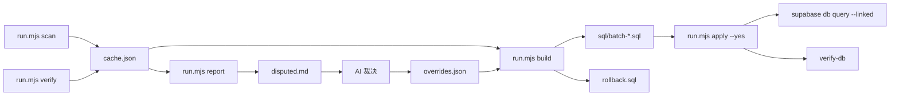

## 用户需求

把「本地 zip 补录进 hentai_archive」从浏览器面板改为**脚本执行**：用 Node 脚本扫描 `Y:\ehviewer\animated`，无头访问 exhentai 校验真实标题，生成分批 SQL，通过 `supabase db query --linked` 写入数据库；**fuzzy 与未找到的争议条目由 AI 裁决**（必要时换关键词重搜、反查候选画廊页）。同时删除已实现的浏览器面板链路。

## 已确认的执行口径

- 面板与相关组件/store/service：**删除**（脚本成为唯一路径）。
- 争议范围：**fuzzy + 未找到都处理**；重搜仍无结果则标 skip 并写明原因。
- 节奏：**先 20 条试跑**，核对匹配率与写入效果后再全量。
- 写入前：**先生成分批 SQL + 统计供审阅**，确认后才调用 CLI 落库。

## 产品/功能概述

一条可断点续跑的命令行流水线：

```
scan → verify（缓存续跑）→ report（争议清单）→ [AI 裁决 → overrides.json]
     → build（分批 SQL + 回滚脚本 + 统计）→ apply（dry-run 默认，--yes 才写库）→ verify-db
```

- `scan`：列出目录下 `.zip`（排除 `.7z`），得出 `fileName / mtime / rawTitle / gidHint`。
- `verify`：用已导出的 cookie 串行搜索 exhentai（2s 限速），解析候选（gid/标题/发布日期），分级 exact / equivalent / fuzzy / notFound；遇 509、sad panda、登录失效立即停止并保留进度。
- `report`：输出 `disputed.md`（文件名 + 前 5 候选 + 打分 + 建议），供 AI 逐条裁决写入 `overrides.json`。
- `build`：合并校验结果与裁决，剔除库内已有 200/304 的画廊，按 title_hash 去重（取最早 mtime），生成 `sql/batch-000N.sql` 与 `rollback.sql`，并给出 matched / equivalent / fuzzy / skip / exists 统计。
- `apply`：默认只打印批次与影响行数；`--yes` 才逐批执行，任一失败即停。
- 验收：`archived_imported` 增加数量等于本批写入数，`import_log_without_archive = 0`，重复执行不产生重复行。

## 关键边界

- 写库绕过 RPC，以 `postgres` 身份执行：必须逐条复刻 `sha256(title)` 派生、gallery upsert、event upsert（`user_id` 显式指定），并补写 `hentai_import_log` 标记。
- `hentai_gallery` 是全局共享目录：脚本内 SQL 采用「gid=0 不覆盖已有非 0」的保护，避免无 gid 条目污染他人写入的真实 gid。
- 判重水位线取 zip 的 mtime（下载时刻 ≥ 画廊发布日期），不会把旧画廊误判成"有新版本"。


## 技术栈

- 运行时：Node 24.17（已装），仅用内置 `fetch` / `fs` / `crypto` / `child_process`，**不新增依赖**（`jsdom` 仅服务已删除的浏览器单测，随面板一并移除）。
- 网络：直接读 `%TEMP%\exhentai-cookies.txt`（已验证可用），固定 Edge 155 UA；限速 2000ms，失败重试 1 次。
- 数据库：`supabase` CLI v2.98.2（已 link `tlxamlurkzfqblzyfztp`），`db query -f file --linked` 执行多语句 SQL；写库以 postgres 身份，绕过 RLS 与 RPC。
- 脚本形态：`.mjs`（ESM），纯函数与副作用分离，便于 vitest 单测；ESLint 只覆盖 `ts/mts/tsx/vue`，脚本需通过 oxlint。

## 实现思路

先做「纯函数层」（解析、归一化、消毒、前缀规则、打分），再用可注入的 `fetch` 封装网络层，最后用 `run.mjs` 串起带缓存的子命令。所有判断都可离线复算：`cache.json` 存原始候选，`build` 只读缓存 + overrides，**不重新请求**，因此 SQL 可反复生成、审阅、幂等执行。

### 匹配与分级（复用已验证的口径）

1. 文件名解析：去 `.zip`；尾部 `[数字]` 若形如 YYYYMMDD 则视为标题的一部分，否则作为 gidHint 并从 rawTitle 剥离。
2. 分级顺序：
   - gidHint 等于某候选 gid → `matched`（gid 比标题可靠）；
   - 归一化（NFKC + 空白压缩 + trim）全等 → `exact`；
   - Windows 消毒后一致、255 截断后一致、或「文件名 ≥20 字符且是候选标题前缀、多余 ≤40 字符」→ `equivalent`；
   - 其余 → `fuzzy`。
3. 自动裁决分数：token Jaccard × 0.6 + 首段方括号 artist 标签一致 × 0.2 + gidHint 命中 × 0.15 + posted 与 mtime 接近 × 0.05。
   - ≥0.85 自动采纳；0.60–0.85 进争议清单；<0.60 skip。
4. 未找到：依次用「去尾部方括号组」「前 6/8 token」「artist 标签单独搜」重试（每轮间隔 2s）；仍为空 → 争议清单，可用 gidHint 反查候选页，最终 skip。

### 争议裁决机制（AI 处理的部分）

- `report` 生成 `disputed.md`：每条含文件名、rawTitle、前 5 候选（gid / 标题 / posted / 分数 / 命中项）、以及建议动作。
- 疑难条目执行 `run.mjs inspect <fileName>`：抓候选画廊页解析标题、分类、页数、发布日期；并用 `tar -tf` 统计 zip 内图片数量与页数比对，输出对照表（不下图、不落盘图片）。
- AI 依据上述信息逐条写入 `scripts/import-zip-archive/overrides.json`，`build` 时校验 gid 必须出现在该条目的候选集合中，防止手误。

### SQL 生成（绕过 RPC 的正确性要求）

- 每批 200 条，一个事务；批次编号 `sql/batch-0001.sql`。
- 批次内顺序：
  1. `do $$` 断言目标 uid 存在且该 uid 下有归档事件（防写错用户）；
  2. gallery upsert：`title_hash = encode(sha256(convert_to(title,'UTF8')),'hex')`，冲突时 `gid = case when excluded.gid > 0 then excluded.gid else gal.gid end`，刷新 `updated_time`（触发器的 hash 一致性与身份不可变仍会生效）；
  3. event upsert：`(user_id, gallery_id, status=200, watermark_date=mtime)`，冲突按约束名更新水位线与 `updated_time`；
  4. 导入日志 upsert：`(user_id, title_hash, title, file_name, file_mtime, gid, status, batch_id)`，`title` 与写库字符串**完全相同**，否则与归档 join 不上；
  5. 断言本批写入行数，`commit;`。
- 幂等：唯一键 + on conflict 保证重复执行不产生重复行；同 title_hash 多文件只写一次（min mtime），其余标 `merged`。
- 回滚：`rollback.sql` 按 batch_id 与 title_hash 删除 event 与 log；`hentai_gallery` 因共享目录与 on delete restrict 不删，文件头注明。



## 实现要点与约束

- **可测性**：`lib.mjs`/`classify.mjs` 全为纯函数（无网络、无 fs），单测覆盖文件名样本（含 `[PATREON] Old Apple WEBP Collection [83272468]`、连续空格、全角、255 截断、YYYYMMDD 方括号）。
- **注入式网络**：`search.mjs` 导出 `createSearcher({ fetchImpl, cookie, ua, intervalMs })`，便于单测与将来换 cookie。
- **HTML 解析不用 jQuery**：正则 + 最小实体解码（`&amp; &lt; &gt; &quot; &#39;`）；解析失败时抛 `parse` 类错误并截取前 500 字符样本，不落整页。
- **断点续跑**：`cache.json` 以 fileName 为键，存 `{rawTitle, gidHint, mtime, status, candidates, keyword, fetchedAt}`；`verify` 只处理缺失或 `error` 项。
- **停止条件**：HTTP 509、页面含 sad panda / ipb_pass、连续 3 条失败 → 立即退出（保留缓存），不自动重试。
- **不打印秘密**：cookie 与完整页面 HTML 一律不进日志；日志只输出文件名、gid、状态、耗时。
- **依赖顺序**：先 `build` 生成 SQL 并人工审阅，再 `apply`；`apply` 失败后可用 `rollback.sql` 撤回已成功批次。

