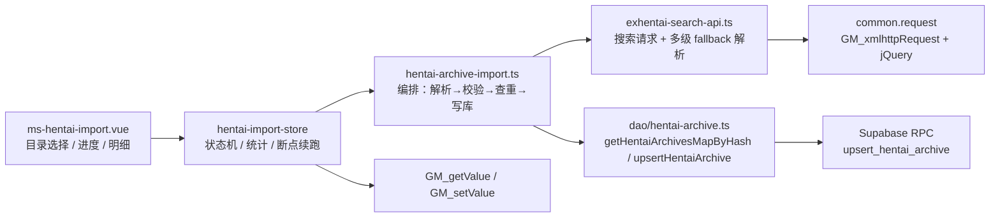

## 用户需求

把 `Y:\ehviewer\animated` 下已下载的 1303 个画廊 zip，补录进 `hentai_archive` 归档体系，使现有 exhentai 判重逻辑（`title_hash`）能识别"已下载"，不再重复下载。

已确认的约束：

- 目标表：`hentai_archive`（视图 → `hentai_gallery` + `hentai_archive_event`），不做任何 schema 变更。
- 执行方式：在用户脚本内新增「本地目录导入」面板，浏览器选目录后读取文件名与修改时间，复用现有登录态与 RPC。
- 标题来源：逐条访问站点校验真实标题，避免文件名非法字符替换 / 255 截断导致 hash 对不上。
- `gid` 统一写 0（仅追溯元数据，不参与判重）；水位线 `date` 用 zip 文件修改时间。

## 产品概述

在 exhentai 页面侧边新增一个导入卡片/弹窗：选择本地目录后自动列出全部 zip，逐条做站点校验，最终以 `status=200`（已下载）写入归档，并给出可复核、可重试、可断点续跑的导入报告。

## 核心功能

- **目录扫描**：选择 `animated` 目录，仅读取 `name` / `lastModified`（不上传、不解压），支持 `.zip`（可含 `.7z`）过滤。
- **文件名解析**：去扩展名；尾部 `[数字]` 识别为 gid 提示并剥离；保留原始标题文本。
- **逐条站点校验**：串行请求 exhentai 搜索，解析真实标题、gid、发布日期；用 NFKC + 空白归一 + Windows 文件名消毒规则比对，分级为「精确匹配 / 等价匹配 / 模糊 / 未找到」。
- **查重与写库**：批量按 `title_hash` 查库；已存在 200/304 的默认跳过（避免用 mtime 覆盖真实水位线、gid=0 覆盖真实 gid），可手动开启覆盖；写库统一 `gid=0`、`date=文件修改时间`、`status=200`。
- **限速与风控**：串行 + 默认 2 秒间隔（可调），失败重试 1 次，检测 509 / 登录失效页面时自动暂停并提示。
- **断点续跑**：校验结果与写入状态持久化到脚本存储，刷新或关页后可继续，已校验条目不再重复请求。
- **结果复核**：统计（总数 / 匹配 / 模糊 / 未找到 / 已存在 / 已写入 / 失败）、分页明细表、单项重试与手工改标题、未匹配清单一键复制、暂停 / 继续 / 清空。
- **安全边界**：只读本地文件元信息；写库受 RLS 约束，必须已登录；同标题多条时取最早 mtime，防止抬高水位线。

## 技术栈

- 语言/框架：Vue 3 + TypeScript（`<script setup>`），Element Plus（已全局注册 + 自动按需引入），Pinia
- 网络：`src/common/common.ts` 的 `request()`（`GM_xmlhttpRequest`，自动带 cookie）
- 解析：jQuery（现有 HTML 解析方式）+ `parseText` 备用；日期统一 dayjs
- 数据：`@supabase/supabase-js`，复用 `useUserStore().getAuthSupabase()` 与既有 DAO/RPC
- 持久化：`GM_getValue` / `GM_setValue`（与 `src/store/config-store.ts` 同一范式）
- 构建：vite + vite-plugin-monkey；`match` / `connect` 已含 `*://*exhentai.org/*`，无需改配置

## 实现思路

新增一条"本地清单 → 站点校验 → 归档写库"的独立流水线，不改动现有下载/判重逻辑，只在 `m-home-site.vue` 增加一个仅 exhentai 可见的入口：

1. 面板用 `<input type="file" webkitdirectory multiple>` 选目录，得到 `FileList`（只读 `name`、`lastModified`），过滤扩展名后生成候选条目。
2. 文件名解析：去扩展名 → 尾部 `\s*\[(\d{4,})\]\s* 记为 `gidHint` 并剥离 → `rawTitle`。
3. 校验：`GET https://exhentai.org/?f_search=<encodeURIComponent(rawTitle)>`（如需限定画廊名可加 `f_sname=on`，以真实页面验证为准），用 `jquery(html)` 解析结果行：优先 `div.gl4t.glname.glink`，fallback `#gn`、`a[href*="/g/"]` 的文本；gid 从 `/g/(\d+)/([0-9a-f]{10})/` 提取；发布日期取 `[id^="posted_"]` 或 `.gl5t` 文本（仅展示核对，不写库）。
4. 比对分级：`normalize(title)`（NFKC + 空白压缩 + trim）全等 → matched；按 Windows 文件名消毒规则（替换 `[\x00-\x1f<>:"/\\|?*]`、去尾部空格与点、255 截断）后与原文件名一致 → 也判 matched；唯一候选但文本不等 → fuzzy（默认不写库，等人工确认）；无候选 → not-found。
5. 查重：把候选真实标题 `sha256Hex` 后分块（每 200 个）调 `getHentaiArchivesMapByHash`；已有 200/304 记录默认标记 exists 跳过。
6. 写库：`upsertHentaiArchive(0, new Date(mtime), HentaiArchiveStatus.DownloadSuccess, realTitle.slice(0,255))`，逐条串行，失败重试 1 次；同一 `title_hash` 多条时只写一次并取 `min(mtime)`。
7. 状态与进度：Pinia store 维护条目状态机与统计，快照写 GM 存储（节流 5 秒 + `visibilitychange` 时强制 flush）；恢复时把 `verifying`/`writing` 回滚为 `pending`。

## 关键决策与权衡

- **不改 schema，gid 写 0**：`hentai_gallery.gid` 是 `not null` 且明确定位为"仅追溯元数据、不参与判重"，写 0 可零迁移落地；代价是丢失真实 gid，但站点真实 gid 已在面板展示，可随时补。
- **date 用 mtime**：mtime 是下载时刻，≥ 画廊发布日期，因此不会把旧画廊误判成"有新版本"，也不会挡住真正的后续更新（更新日期会大于 mtime）。比"写当前时间"安全得多。
- **默认跳过已存在记录**：`upsert_hentai_archive` 会覆盖 `watermark_date` 与 `gid`，盲目导入会把真实水位线降级为 mtime、真实 gid 覆盖成 0，因此默认只补空缺，覆盖需显式开启。
- **逐条搜索而非本地猜标题**：文件名存在消毒/截断，靠本地猜测必然大量 hash 落空；一次搜索可同时拿到真实标题与 gid，是唯一可靠口径。代价是 1303 次请求（2 秒间隔约 45 分钟），用串行 + 断点续跑 + 自动暂停兜住。
- **不引入新库/新表**：复用 `hentai-archive` DAO 与现成队列范式（`download-queue-store` 的 pending/running/success/failed + interval 思路），避免技术债。

## 性能与可靠性

- 请求串行、间隔 2000ms（可调 1000–5000ms），单轮失败重试 1 次；连续 3 次失败或命中 509 / 无结果表格（登录失效）→ 暂停并提示，避免 IP 被封。
- 解析复杂度 O(结果行数)，单页通常 ≤ 25 行；查重分块 200 个 hash，规避 `.in()` URL 过长。
- 表格按 50 条/页渲染，避免 1303 行全量 DOM；store 只存轻量对象（≈ 数百 KB），写盘节流。
- 边界：标题超 255 截断（与线上 `extractTitle` 一致）；同标题多条取 min(mtime)；mtime 超出 [今天-5 年, 今天] 标"可疑"需人工确认；写入失败可单条重试；页面刷新不丢进度。

## 架构设计



## 目录结构

```
mansion/
├── src/
│   ├── common/
│   │   ├── filename.ts                # [NEW] 文件名工具：去扩展名、剥离尾部 [gid]、标题归一化（NFKC+空白压缩）、Windows 消毒规则、候选等价判定、长度截断。纯函数、无副作用，便于单测。
│   │   └── filename.test.ts           # [NEW] 纯函数单测：`Mix WEBP Part1 [AI Generated] [4008003].zip`、`千夏.zip`、连续空格、尾部点/空格、非法字符、255 截断等样例（vitest，`npm run test`）。
│   ├── dictionary/
│   │   └── index.ts                   # [MODIFY] 新增 IMPORT_DEFAULTS（intervalMs 2000、retry 1、pageSize 50、storageKey、允许扩展名）与 IMPORT_STATUS 文案映射；沿用现有 enum/常量集中管理风格，日期格式化走既有 FORMAT。
│   ├── site/exhentai/
│   │   └── exhentai-search-api.ts     # [NEW] 搜索接口：`searchGalleryByTitle(title): Promise<SearchCandidate[]>`。用 `request(url, 'https://exhentai.org/')` 取 HTML，`jquery(html)` 解析 gid / 真实标题 / posted 日期，多级 selector fallback；识别 509、登录失效（无结果表格）并抛出可分类错误。
│   ├── dao/
│   │   └── hentai-archive-import.ts   # [NEW] 导入编排：目录 FileList → 解析 → 串行限速校验 → 归一比对分级 → 分块查重（复用 getHentaiArchivesMapByHash）→ 逐条 upsertHentaiArchive(0, mtime, 200, 真实标题)；负责同标题去重取 min(mtime)、失败重试、暂停/恢复、进度回调。不直接操作 DOM/UI。
│   ├── store/
│   │   └── hentai-import-store.ts     # [NEW] Pinia store：条目状态机（pending/verifying/matched/fuzzy/not-found/exists/writing/written/failed）、统计 getters、pause/resume/retry/clear/updateTitle、GM 快照读写与恢复（verifying→pending 回滚、节流 persist）。
│   └── components/
│       ├── ms-hentai-import.vue       # [NEW] 面板：exhentai 侧边按钮 + el-dialog；目录选择（webkitdirectory）、间隔设置、覆盖开关；el-progress + 统计标签；分页 el-table 明细（文件名/真实标题/日期/状态/操作）；单项重试、手工改标题、复制未匹配与失败清单、暂停/继续/清空；参考 ms-download-queue.vue 的卡片与窄屏徽标写法。
│       └── m-home-site.vue            # [MODIFY] 在右侧容器内新增 `<ms-hentai-import v-if="site instanceof Exhentai" />`，与既有 `<ms-download-queue>` 同级，不影响其他站点。
```

## 关键数据结构

```ts
export type ImportItemStatus =
  | 'pending'   // 待校验（刷新后 verifying 回滚到此）
  | 'verifying' // 校验中
  | 'matched'   // 精确/等价匹配，可自动写库
  | 'fuzzy'     // 模糊命中，需人工确认
  | 'notFound'  // 未找到
  | 'exists'    // 库内已有 200/304，默认跳过
  | 'writing'
  | 'written'   // 已写入
  | 'failed'

export interface HentaiImportItem {
  fileName: string
  mtime: number      // zip lastModified，用作水位线 date
  rawTitle: string   // 去扩展名、剥离尾部 [gid]
  gidHint?: number   // 文件名尾部 [数字]，仅提示
  status: ImportItemStatus
  realTitle?: string // 站点校验得到的真实标题（写库口径）
  gid?: number       // 站点真实 gid，仅展示，写库仍为 0
  postedDate?: number// 站点发布日期，仅核对
  message?: string
}
```

## 执行注意

- 复用 `request()` 与 `jquery(html)` 的既有写法（参考 `fetchTorrentsFromDownloadPage`），不要另造请求层。
- 标题写库前统一 `trim().slice(0, 255)`，与 `exhentai.ts` 的 `extractTitle` 保持同一口径，否则 hash 与列表页不一致。
- 日志沿用 `console` + `ElNotification`：不打印 cookie、不打印整页 HTML；selector 失效时只截取前 500 字符并标注条目名，便于现场调选择器。
- 影响面控制：仅新增文件 + `m-home-site.vue` 一行挂载 + `dictionary` 常量；不触碰现有判重、下载、队列逻辑。
- 首次落地先跑「前 20 条 + 暂停/继续 + 刷新恢复 + 单条重试」再全量，避免 45 分钟空转后才发现 selector 不匹配。

## Agent Extensions

### SubAgent

- **code-explorer**
- Purpose: 在编码前复核 exhentai 搜索页真实 DOM 结构（结果行/标题/日期/gid 链接）与项目内 Element Plus + Pinia 的既有用法，产出可直接落地的 selector 清单与复用点。
- Expected outcome: 一份确认过的解析选择器与组件/状态复用清单，降低搜索解析写错、返工 45 分钟全量试跑的风险。

### Skill

- **supabase**
- Purpose: 校验导入写路径与既有数据库契约一致（`upsert_hentai_archive` 参数/返回、`title_hash` 触发器约束、RLS 与登录前提、并发 upsert 的覆盖语义），并给出错误分类处理建议。
- Expected outcome: 明确的写库调用契约与失败处理清单（含 RLS 拒绝、schema cache、约束冲突场景），保证 1303 条写入不会大面积静默失败。