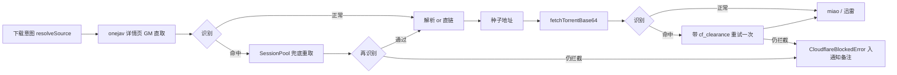

## 需求概述

onejav 的下载链路（`/torrent/...` 详情页解析、`.torrent` 文件获取）会被 Cloudflare 拦截，现有代码把拦截页当成普通失败处理，用户只看到「onejav 也没有可下载种子」「响应不是有效的种子文件」这类含糊提示。需要在下载链路中明确识别「这是 Cloudflare 拦截」，区分拦截形态，并在识别命中后自动兜底重取；兜底仍失败时，把可定位的原因写入下载通知的备注。

## 核心功能

- **拦截识别**：根据响应状态、响应头与页面特征判断是否为 Cloudflare 挑战页、封禁页或限流页，不再把 404、正常业务页、正常种子二进制误判成拦截。
- **区分形态**：至少区分「JS 挑战（challenge）」「访问被拦截（blocked/WAF）」「请求过快（rate-limited）」，并采集 Ray ID 便于排查。
- **自动兜底**：详情页解析命中拦截时，改由已配置的浏览器会话服务重新取页面；一旦兜底成功，本次页面会话内后续请求直接走兜底通道，避免重复撞墙。
- **种子下载兜底**：种子文件命中拦截时，先用兜底通道换取过挑战所需的凭据，再带凭据重取一次；仍被拦截则明确报「被 Cloudflare 拦截」。
- **原因入回执**：拦截原因作为备注出现在下载通知里，用户能一眼看出是「被 Cloudflare 拦截」而不是「没有种子」或「链接失效」。
- **统一判定口径**：javdb 侧原本「状态码非 200 就算被拦」的粗判定一并换成同一套识别规则。

## 现状与问题定位

已核实的调用链：

- `src/site/onejav/onejav-api.ts` 的 `resolveOnejavTorrent(detailUrl)` 用 `src/common/common.ts` 的 `request()`（GM_xmlhttpRequest，**不校验状态码，非 2xx 也 resolve**）取 `/torrent/...` 页面，然后：
- `res.finalUrl === fullUrl` 就直接当直链返回 —— 而 Cloudflare 挑战页的 `finalUrl` 恰好就是原 URL，这里是**误判源头**；
- `finalUrl` 含 `file.onejav.com` 时返回该地址；
- 否则从 `responseXML` 找 `a[title='Download .torrent']` 的 href，找不到返回 `null`，调用方抛出「onejav 也没有可下载种子（javdb 未命中：…）」。
- `src/download/torrent.ts` 的 `fetchTorrentBase64(url)` 用 `responseType: 'arraybuffer'` 取种子，只校验「非空 / ≤5MiB / 首字节 0x64」，失败统一报「响应不是有效的种子文件（链接可能失效或需要登录）」；该文案经 `src/download/miao.ts` 的 `describeMiaoError` 原样变成 miao 回退原因，最终进通知备注（`src/download/notice.ts` 的 `notes`）。
- `src/site/javdb/javdb-api.ts` 已有 `isCloudflareBlocked = status !== 200 || text.includes('Just a moment...')`，并配 `bypassSuccess` 标志 + `SessionPool` 兜底，思路可复用但其判据会把 404/限流一并算作 CF（需修正）。
- 可复用的基础设施：`src/common/flare-solverr.ts`（`getFromFlareSolverr` / `createSession` / `destroySession` / `withRetry` / `FlareSolverrError` / `GmCallbackCookie`）、`src/common/session-pool.ts`（按 site 分桶 + 并发锁 + TTL 持久化，`pool.request(site, url, cookies)` 返回 `{ solution }`，`solution.response` 是 HTML 文本、`solution.cookies` 是 `Record<string, string>`）。
- 已确认 `GmResponseEvent` 含 `status / statusText / responseHeaders / finalUrl / responseText / responseXML`，识别所需字段无需新增请求能力，`common.ts` 的 `request()` **不需要改**（控制爆炸半径）。

## 技术栈

沿用现有栈，不引入新依赖：Vue 3 + TypeScript + Vite + vite-plugin-monkey 油猴脚本；HTTP 走 GM_xmlhttpRequest；兜底走现有 FlareSolverr 会话池；测试用 vitest + happy-dom（`npm run test`）、`npm run lint`、`npm run type-check`。

## 实现方案（三层）

### 1. 识别层：`src/common/cloudflare.ts`（纯函数，零 IO）

输入一个「响应探针」（状态码、响应头原始字符串、响应体前若干字节/文本、最终 URL），输出拦截结论或 `null`。多信号加权，任一强信号即判定，避免依赖易变的单一文案。

| 信号 | 特征 | 判定 |
| --- | --- | --- |
| 响应头 | `cf-mitigated: challenge` | challenge（最强） |
| 响应头 | `server: cloudflare` 且 `cf-ray` 存在，状态 403 / 503 | blocked |
| 响应头 | `cf-ray` 存在，状态 429 | rate-limited |
| 页面 | `Just a moment...`、`_cf_chl_opt`、`/cdn-cgi/challenge-platform/`、`Enable JavaScript and cookies to continue` | challenge |
| 页面 | `Attention Required! | Cloudflare`、`cf-error-details`、`error code: 1020`、`Sorry, you have been blocked` | blocked |
| 最终 URL | 含 `/cdn-cgi/challenge-platform/` 或 `/cdn-cgi/l/chk_` | challenge |
| 负向约束 | 404 / 410、正常业务 HTML、bencode 二进制（首字节 0x64） | 不判为 CF |


同时导出：`CloudflareBlockedError`（携带 `kind / status / rayId`，`message` 即可直接进通知的中文文案，形如「onejav 被 Cloudflare 拦截（challenge，Ray 8f2a1c…），FlareSolverr 兜底未成功：…」）。

### 2. 兜底层：`src/common/cloudflare-guard.ts`（站点无关）

- `fetchPageThroughCloudflare({ site, url, referer, cookieDomain })`：

1. GM 直取 → 识别；未命中直接返回 HTML 与 `via: 'direct'`；
2. 命中 → 取站点 cookie（新增 `listCookies(domain)`，从 javdb 的 `getCookies` 泛化）→ `SessionPool.request(site, url, cookies)` → 对 `solution.response` / `solution.status` 再识别一次；
3. 通过 → 返回 HTML，置 `bypass[site] = true`（此后该站点页面请求直接走兜底），并缓存 `solution.cookies` 中的 `cf_clearance`（内存，20 分钟上限，**不写 GM 存储、不进日志**）；
4. 仍拦截或 FlareSolverr 不可用（`FlareSolverrError`/`ThunderTransportError` 类网络错）→ 抛 `CloudflareBlockedError`，把底层原因拼进文案。

- `ensureClearance(site, warmupUrl)`：给二进制链路预热凭据；`getClearanceCookieHeader(site)`：返回可注入的 `cf_clearance=...` 头。

关键取舍：FlareSolverr 的 `request.get` 只返回文本，**不能代下二进制种子**；因此种子链路的兜底只能「先过挑战拿 `cf_clearance`，再让 GM 请求带 Cookie 重试」。`cf_clearance` 与 UA/IP 绑定，若预热用的无头浏览器 UA 与当前浏览器不一致，重试可能仍被拦 —— 这种情况明确报「已尝试换取凭据后重取仍被拦截，请在浏览器打开 onejav 通过验证后重试」，而不是静默失败。

### 3. 接入层

- `src/site/onejav/onejav-api.ts`：重写 `resolveOnejavTorrent`。
- 先走 `fetchPageThroughCloudflare`（site=`onejav`，referer=`https://onejav.com/`，domain=`onejav.com`），**判定优先于分支**；
- 「直链」判定从 `finalUrl === fullUrl` 收紧为：`content-type` 含 `application/x-bittorrent` / `octet-stream`，或响应体首字符不是 `<`（即不是 HTML）；
- `file.onejav.com` 重定向仍视为直链；
- 其余按 HTML 解析 `a[title='Download .torrent']`，取不到仍返回 `null`（保持调用方「没有可下载种子」的文案），只有确认为拦截时才抛 `CloudflareBlockedError`，避免把「确实没有种子」误报成拦截。
- `src/download/torrent.ts`：`fetchTorrentBase64(url, options?: { clearanceSite?: string })`。`onload` 里先把前 8KB 转文本并识别；命中 → 若传了 `clearanceSite`，带 `Cookie` 头（沿用现有 `Referer`）重试一次，仍命中则抛 `CloudflareBlockedError`；非 CF 且非 bencode 时保留原「有效的种子文件（链接可能失效或需要登录）」文案（不破坏既有测试与语义）。
- `src/download/miao.ts`：`resolveSeedSource` 增加站点标识入参，仅当站点为 onejav 时传 `clearanceSite: 'onejav'`。
- `src/site/javdb/javdb-api.ts`：`isCloudflareBlocked` 改为调用 `detectCloudflareBlock`（非 2xx 不再一律算 CF，仍把 404/业务失败按原有 reject 文案处理），`getCookies` 改用共用 `listCookies`；`bypassSuccess` 控制流保持不变。

## 数据流



## 执行注意

- **性能**：识别只扫响应体前 8KB，O(n) 常数级；`bypass` 标志避免每次双请求；`SessionPool` 按 site 串行加锁，多个番号并发下载时兜底请求会排队，仅在命中拦截时才付出该代价（正常路径零额外请求）。
- **日志**：沿用 `[onejav] / [cloudflare] / [miao]` 前缀的 `console.warn`；只记录 `kind / status / rayId / 站点 / URL`，不打印整页 HTML，`cf_clearance` 一律脱敏（仅记长度）。
- **爆炸半径**：不改 `common.ts` 的 `request()`、不改 `intent.ts` 结局四态、不改通知渲染；javdb 控制流保持等价，仅替换判据实现；新增错误类型统一继承 `Error` 并保留 `name`，`describeMiaoError` 的兜底分支仍能取到 `message`。
- **安全**：`cf_clearance` 属会话凭据，仅内存缓存、不进 GM 存储、不落日志。

## 目录结构

```
d:/workspace/mansion/
├── src/
│   ├── common/
│   │   ├── cloudflare.ts                     # [NEW] Cloudflare 拦截识别层：探针类型、多信号判定（响应头 / 状态码 / 页面特征 / finalUrl）、Ray ID 提取、CloudflareBlockedError 与中文文案。纯函数、无 IO、无 DOM 依赖，便于单测。
│   │   ├── cloudflare-guard.ts               # [NEW] 兜底编排：fetchPageThroughCloudflare（GM 直取 → 识别 → SessionPool 重取 → 再识别）、按 site 的 bypass 标志、cf_clearance 内存缓存（TTL 20 分钟）、ensureClearance / getClearanceCookieHeader。失败统一抛 CloudflareBlockedError 并拼接底层原因。
│   │   └── flare-solverr.ts                  # [MODIFY] 新增 listCookies(domain)：GM_cookie.list 的 Promise 封装（从 javdb-api 的 getCookies 泛化），供兜底与预热共用；其余导出保持不变。
│   ├── site/
│   │   ├── onejav/onejav-api.ts              # [MODIFY] 重写 resolveOnejavTorrent：先识别后分支；直链判定改为 content-type / 非 HTML 首字节；拦截命中走兜底；确认为拦截才抛 CloudflareBlockedError，解析不到仍返回 null。
│   │   └── javdb/javdb-api.ts                # [MODIFY] isCloudflareBlocked 改为调用 detectCloudflareBlock（修正 404 误判），getCookies 改用 listCookies；fetchPageDoc 与 bypassSuccess 控制流不变。
│   └── download/
│       ├── torrent.ts                        # [MODIFY] fetchTorrentBase64 增加 options.clearanceSite；onload 先做前 8KB 的 CF 识别，命中则带 cf_clearance 重试一次，仍失败抛 CloudflareBlockedError；非 CF 非 bencode 保留原文案。
│       └── miao.ts                           # [MODIFY] resolveSeedSource 接收站点标识，站点为 onejav 时传 clearanceSite，使种子链路可触发兜底重试。
├── src/__tests__/
│   ├── cloudflare.test.ts                    # [NEW] 识别矩阵：cf-mitigated、Just a moment、challenge-platform、cf-error-details、1020、429+cf-ray、404 不误判、正常 HTML 不误判、bencode 字节不误判、Ray ID 抽取与文案。
│   ├── onejav-cloudflare.test.ts             # [NEW] mock request / SessionPool：正常 HTML 解析、finalUrl 等于原 URL 的挑战页不再误判直链、兜底成功后可解析 href、兜底失败抛 CloudflareBlockedError 且文案含原因。
│   └── torrent.test.ts                       # [MODIFY] 新增：挑战页 HTML → CloudflareBlockedError；带 clearanceSite 时重试一次并成功；无 clearanceSite 时不重试。
└── docs/
    ├── CONTEXT.md                            # [MODIFY] 术语表补充「Cloudflare 拦截（challenge / blocked / rate-limited）」「兜底重取」「clearance 预热」，与既有「回退」口径区分。
    └── adr/0002-cloudflare-detection-and-fallback.md  # [NEW] 记录决策：多信号识别的理由、为何 status 单独不足以判定、二进制无法由 FlareSolverr 代下故采用 cf_clearance 重试及其 UA 绑定局限。
```

## 关键代码结构

```ts
/** 响应探针：把一次 GM 响应里可用的判据收拢成纯数据，便于单测与复用 */
export interface CloudflareProbe {
  status: number
  /** GM_xmlhttpRequest 的 responseHeaders 原始字符串 */
  responseHeaders?: string
  /** 响应体前 8KB（HTML 文本；二进制链路先解码为文本） */
  body?: string
  finalUrl?: string
}

export type CloudflareBlockKind = 'challenge' | 'blocked' | 'rate-limited'

export interface CloudflareBlock {
  kind: CloudflareBlockKind
  status: number
  rayId?: string
  /** 命中的具体信号，仅用于日志与诊断，不直接展示给用户 */
  evidence: string
}

/** 未拦截返回 null；命中返回结构化结论 */
export function detectCloudflareBlock(probe: CloudflareProbe): CloudflareBlock | null

export class CloudflareBlockedError extends Error {
  readonly block: CloudflareBlock
  constructor(site: string, block: CloudflareBlock, cause?: string)
}
```