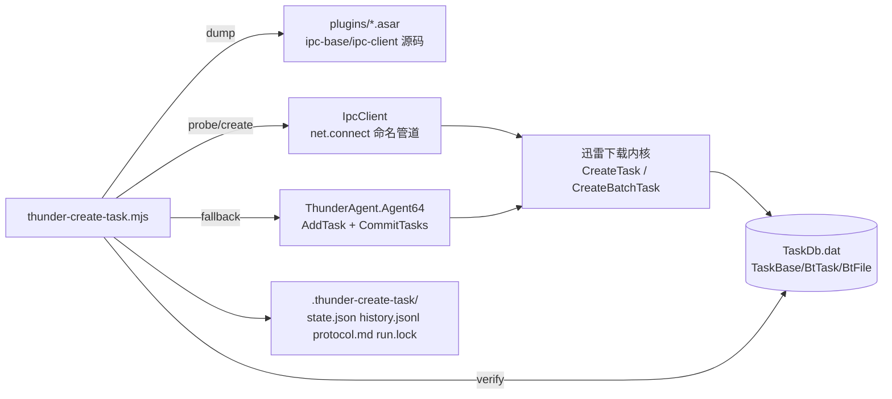

## 需求概述

为迅雷写一个**独立实验脚本** `scripts/thunder-create-task.mjs`：绕过「新建任务面板」，直接从脚本调用迅雷客户端内部下载内核的 `CreateTask` 函数（私有 IPC），把种子加入任务列表，并支持按文件勾选（等价面板里的勾选位）。

## 核心功能

- **取证子命令**：从迅雷 `resources/app/plugins/*.asar` 中抽出 `ipc-base.js` / `ipc-client.js` 源码（asar 内嵌 sourcemap），产出协议笔记（消息分帧、握手、调用与回包格式、错误码）。
- **连接与探测**：自动发现 `\\.\pipe\*xunlei-node-net-ipc*` 命名管道，完成握手；`probe` 只校验 `CreateTask` 是否存在，不创建任务。
- **调用 CreateTask**：按 torrent/magnet 组装 `newTaskInfo`，调用 `CreateTask(taskType, newTaskInfo)`；可选 `CreateBatchTask`。
- **选文件**：`--files 1,3,5` / `--exclude-files 2` 映射为 `subFileStats` 的勾选位，入库后用 `BtFile.Download` 校验是否生效。
- **验证与回退**：调用后轮询 `TaskDb.dat` 等对应 info hash 出现；失败时记录失败阶段与原因，并可自动回退现有 COM（`AddTask + CommitTasks`）。
- **可观测**：`state.json`（阶段：connect / handshake / probe / call / verify）、`history.jsonl`（追加式）、`--verbose` 打印原始报文（截断）、单实例锁，避免与 thunder-sync 抢管道。
- **不改动现有主流程**：`thunder-sync.mjs` 保持原样，新脚本自带 CLI 与状态目录，纯实验性质。

## 技术栈

- 运行环境：Node.js 24 ESM（与仓库 `package.json` 的 volta Node 24.17.0 一致），**零第三方依赖**。
- 传输层：`node:net` 连接 Windows 命名管道（`\\.\pipe\...`）。
- 数据校验：`node:sqlite` 只读复制 `TaskDb.dat`（复用 `thunder-sync.mjs` 的复制+重试策略）。
- 取证：纯 JS 解析 asar（8 字节 pickle + JSON header + 数据区），必要时读 sourcemap 的 `sourcesContent`。
- 回退通道：`powershell.exe` + `ThunderAgent.Agent64` COM（复用现有 PS 片段）；管道枚举也用 PowerShell `Get-ChildItem \\.\pipe\`（Node 无列举 API）。

## 实现方案

### 总体策略

分五步、可独立验证：①取证拿到协议 → ②写出最小 IPC 客户端并 `probe` → ③组装 `newTaskInfo` 调 `CreateTask` → ④验证入库 + 选文件对齐 → ⑤回退与可观测收口。每步都落盘证据（`protocol.md` / `state.json`），失败可定位到具体阶段，不会“静默无效”。

### 关键技术决策

1. **先取证后编码**：协议细节（分帧方式、是否长度前缀、`rid` 配对、握手字段）以 asar 内 `ipc-base.js` / `ipc-client.js` 源码为准，不靠猜。已确认这些包内含 sourcemap 与 `sourcesContent`（`StartPage/1.1.1.asar`、`ThirdPanPlugin/1.0.4.asar` 等），可行。
2. **管道自动发现 + 手动覆盖**：已知模式 `\\.\pipe\<socketPrex>-xunlei-node-net-ipc-{FD196984-2591-4588-AA6F-5C8AC1266290}.sock`，本机实际存在 `...\Temp\Thunder-xunlei-node-net-ipc-{FD196984-...}.sock`。实现上先枚举含 `xunlei-node-net-ipc` 的管道，再按前缀 `Thunder` 优先，`--pipe` 可覆盖；GUID 变化时仍可命中。
3. **握手复刻插件身份**：常量已知 `serverContextName='xunlei-node-net-ipc-server-{46105371-DE78-4442-B59F-FDA1D6D7D430}'`、`mainRendererContext='main-renderer'`；`xlIpc.key` 形如 `vip-pay-center-E240B663-...`（每个插件一个）。若服务器强校验 key，则从目标插件 asar 里现取同名 key（取证子命令顺带输出候选 key 列表），仍被拒就记录 `stage=handshake` 并回退，不做暴力试探。
4. **`CreateTask` 参数对齐**：以 `ThirdPanPlugin/1.0.4.asar` 里 `ipcBatchCreateTask` / `callServerFunction('CreateTask', taskType, mainNewTaskInfo)` 的实际字段为准（`url`、`savePath`、`name`、`subDir`、`subFileStats`、`userAgent`、`statClick`、`groupTaskInfo.subTaskList`）。`taskType` 先由 asar 常量表取值，取不到则 `--task-type` 手工指定并记录。
5. **选文件用真实索引**：`thunder-sync.mjs` 的 `parseTorrent()` 只返回 `length / fileCount`，**不含逐文件列表**，新脚本需自带 `parseTorrentFiles()`（遍历 `info.files` 得 `index / path / size`），把勾选映射到 `subFileStats`，再用 `BtFile`（`FileIndex / Download / FileSize`）回读校验，形成闭环。
6. **回退是显式的一等公民**：`--engine ipc`（默认）/`com`；IPC 任一步失败 → 记录原因 → 若未 `--no-fallback` 则走 COM 同一任务，最终结果标注 `via: ipc|com|none`。

### 性能与可靠性

- 单次 `CreateTask` 为一次管道往返（预期毫秒级）；握手只做一次并复用连接，批量 N 个任务不重复建连。
- 验证阶段每次轮询都要复制约 3 MB 的 `TaskDb.dat(+wal)`，默认 2 s 一次、可配 `--poll`；`-shm` 常被迅雷独占，沿用现有“重试 10 次 + 允许跳过”的策略。
- 单实例锁（`run.lock` 记 pid/host）：避免两个进程同时抢占同一管道会话；锁过期或进程已死则接管。
- 不做 UI 自动化（已实测：`SendKeys` / `PostMessage WM_KEYDOWN` / UIA `InvokePattern` 对 Chromium 面板均无效），避免引入不可维护路径。

### 可观测性（用户明确要求）

每次调用在 `history.jsonl` 追加一条，字段固定：

`ts / action / pipe / context / keySource / taskType / stage(connect|handshake|probe|call|verify) / ok / errorCode / errorMsg / taskId / infoHash / fileSelection / panelDetected / fallback{used,result} / durationMs`

`state.json` 保存最近一次运行汇总 + 每个任务的最终结论；`--verbose` 打印收发报文（>2 KB 截断并标注长度）。

## 架构设计



分层：`dump`（取证）→ `ipc`（连接/握手/调用/错误映射）→ `task`（newTaskInfo 组装、选文件）→ `verify`（TaskDb 校验）→ `fallback`（COM）→ `state`（落盘）。各层单独可测，互不依赖内部实现细节。

## 目录结构

```
d:/workspace/mansion/
├── .gitignore                                  # [MODIFY] 追加 .thunder-create-task/
├── scripts/
│   ├── thunder-sync.mjs                         # [不动] 复用其纯函数思路（解析种子/读库/COM 片段）
│   ├── thunder-create-task.mjs                  # [NEW] 单文件 CLI：dump / probe / add / status
│   └── .thunder-create-task/                    # [NEW] 运行期状态（git 忽略）
│       ├── state.json                           # [NEW] 最近一次运行汇总 + 每任务结论（stage/ok/error/fallback）
│       ├── history.jsonl                        # [NEW] append-only 调用流水（每行一次 dump/probe/call）
│       ├── protocol.md                          # [NEW] 逆向笔记：分帧/握手/回包/错误码/字段表（由 dump 产出）
│       ├── dump/                                # [NEW] 抽出的 ipc-base.js / ipc-client.js 及 sourcemap（取证用，可删）
│       ├── db/                                  # [NEW] TaskDb 只读副本（验证阶段）
│       └── run.lock                             # [NEW] 单实例锁（pid + host + 启动参数）
```

### 文件职责说明

**`scripts/thunder-create-task.mjs`（新建，单文件，约 700~900 行）**

- `dump`：定位 `resources/app/plugins/StartPage/*`（版本号可变，取最高版本）与 `ThirdPanPlugin/*`，解析 asar，抽出 `ipc-base.js`、`ipc-client.js` 及其 `.map`；从 `sourcesContent` 提取源码；扫描 `key` / `taskType` / `CreateTask` / `subFileStats` 上下文，输出到 `protocol.md` 与 `dump/`。
- `probe`：枚举管道 → 连接 → 握手 → `checkServerFunction('CreateTask')`，打印并落盘结果；不创建任务。
- `add`：读 `--torrent` / `--dir`，解析 info hash、name、逐文件列表 → 若 `--engine ipc` 调 `CreateTask`；`--dry-run` 只打印将要发送的 `newTaskInfo`（脱敏、截断）。
- `verify`：轮询 TaskDb 等 `InfoId`；`--expect-files` 时核对 `BtFile.Download` 与 `--files/--exclude-files` 一致。
- `status`：打印 `state.json` 汇总 + 最近 N 条 `history.jsonl`（含失败阶段与原因）。
- 内置：`parseTorrentFiles()`（bencode 遍历 `info.files`）、`buildMagnet()`、`readThunderTasks()`/`safeReadTasks()`/`copyDbFile()`（复制重试，`-shm` 可跳过）、`isNewTaskPanelOpen()`（复用 EnumWindows 思路，用于标记 `panelDetected`）、COM 回退片段（`AddTask + CommitTasks`）。
- 参数：`--torrent`（可多次）/`--dir`、`--save`、`--files`/`--exclude-files`、`--engine ipc|com`、`--no-fallback`、`--pipe`、`--task-type`、`--dry-run`、`--poll`、`--timeout`、`--verbose`、`--profile`（TaskDb 所在 Profiles 目录）。

**`.gitignore`（修改）**

- 追加 `.thunder-create-task/`，与已有 `.thunder-sync/` 一致，避免状态/日志入库。

## Key Code Structures

```ts
// 协议帧：字段名来自 asar 内源码，实际必填项以 protocol.md 实测为准
interface IpcRequest {
  rid: number            // 请求 id，用于回包配对
  funcName: string       // 'CreateTask' | 'CreateBatchTask' | ...
  param: unknown[]       // CreateTask 即 [taskType, newTaskInfo]
  productId?: string     // 插件身份，取值见 plugin-loader-config.json
  context?: string       // main-renderer / main-process
}

interface SubFileStat {         // 面板里的“勾选位”等价物
  index: number                 // = torrent info.files[i] 的序号，落库后对应 BtFile.FileIndex
  path?: string
  size: number
  download: 0 | 1
}

interface NewTaskInfo {
  url: string                   // magnet:?xt=urn:btih:...&dn=...&tr=...
  name: string
  savePath: string
  subFileStats?: SubFileStat[]
  groupTaskInfo?: { subTaskList: NewTaskInfo[] }
  userAgent?: string
  statClick?: string
  subDir?: string
}

interface CallRecord {          // history.jsonl 每行
  ts: string
  action: 'dump' | 'probe' | 'add' | 'verify'
  stage: 'connect' | 'handshake' | 'probe' | 'call' | 'verify'
  ok: boolean
  pipe?: string; context?: string; keySource?: string; taskType?: number
  errorCode?: string; errorMsg?: string
  taskId?: number | string; infoHash?: string
  panelDetected?: boolean
  fallback?: { used: boolean; result: 'ok' | 'failed' | 'skipped' }
  durationMs?: number
}
```

## 实施顺序与验证判据

| 步骤 | 验证判据 |
| --- | --- |
| 取证 | `protocol.md` 能写清“分帧方式 + 握手报文 + 回包格式 + 错误码”，且抽出 `ipc-client.js` 源码可读 |
| probe | 连接成功、握手有回包、`CreateTask` 存在性明确（存在/不存在都算结论） |
| add 单任务 | 调用返回 taskId 或明确错误；`TaskDb` 中出现对应 `InfoId`，且**未弹出「新建任务面板」** |
| 选文件 | `--exclude-files 2` 后 `BtFile.Download` 对 `FileIndex=2` 为 0，其余为 1 |
| 回退 | 人为指定错误管道（`--pipe 假的`）时，记录 `stage=handshake/connect` 失败并自动走 COM 成功 |
| 可观测 | `history.jsonl` 每条都有 stage/ok/error；`status` 能还原失败原因 |